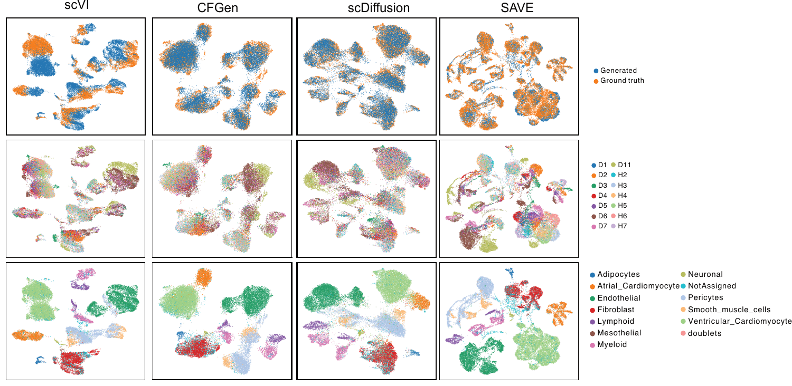
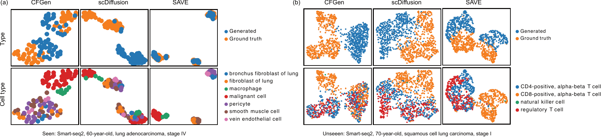
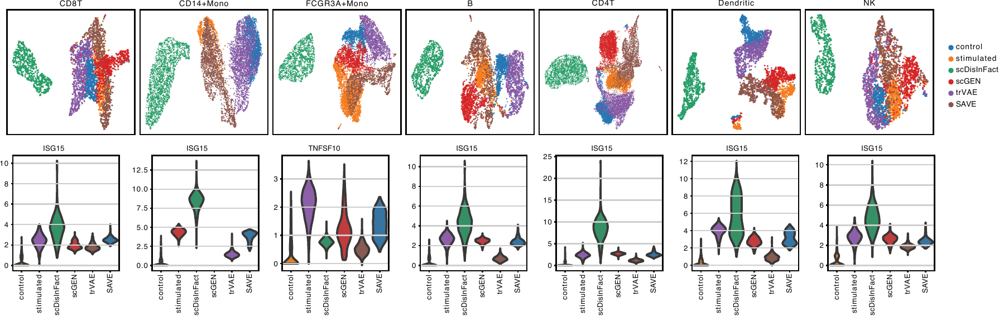

<div align="center">

<h1>SAVE: A Generalizable Framework for Multi-Condition Single-Cell Generation with Gene Block Attention</h1>

<p>
  <strong>Jiahao Li</strong>, Jiayi Dong, Peng Ye, Xiaochi Zhou, Haohai Lu, Fei Wang<sup>*</sup>
  <br/>
  <em>College of Computer Science and Artificial Intelligence, Fudan University</em>
</p>

<p>
  <a href="https://colab.research.google.com/github/fdu-wangfeilab/sc-save/blob/main/notebooks/SAVE_ICLR2026_Reproduce_Colab.ipynb"></a>
  <a href="https://openreview.net/forum?id=l7QEoK4uDP"></a>
  <a href="https://arxiv.org/abs/2604.16776"></a>
  <a href="LICENSE"></a>
  <a href="#environment-installation"></a>
  <a href="#environment-installation">= 2.2" /></a>
</p>

<p>
  <a href="#overview">Overview</a> &middot;
  <a href="#key-results">Key Results</a> &middot;
  <a href="#iclr-2026-reproduction-quickstart">Reproduce ICLR 2026</a> &middot;
  <a href="#biological-interpretability">Interpretability</a> &middot;
  <a href="#environment-installation">Installation</a> &middot;
  <a href="#quick-start">Usage</a> &middot;
  <a href="#citation">Citation</a>
</p>

</div>

---

## Overview

**SAVE** is a unified conditional generative framework for multi-condition single-cell RNA-seq modeling. Instead of attending over ~20,000 flat gene tokens, SAVE groups semantically related genes into balanced **Gene Blocks** and combines a latent Variational Autoencoder with masked **Optimal-Transport Flow Matching** to model complex biological and technical covariates within a single architecture.

- **Gene Block Attention (191× Speedup):** Partitions LLM-embedded NCBI gene summaries into $L$ balanced functional blocks of size $K = 3200$ via Optimal Transport clustering, reducing Transformer complexity from $\mathcal{O}(G^2)$ to $\mathcal{O}(L^2)$ (12.5 min vs. 2391.2 min on a single RTX 3090 24GB).
- **Masked Condition Modeling & Multi-Condition CFG:** Injects arbitrary biological/technical covariates via Adaptive Layer Normalization (`AdaLN`) with independent condition masking ($p = 0.6$) and multi-condition Classifier-Free Guidance, enabling zero-shot extrapolation to **unseen condition combinations** across 1–5 covariates.
- **Unified SOTA Performance:** Using one fixed configuration across **8 benchmarks**, SAVE achieves state-of-the-art results on **conditional generation**, **batch effect correction** (without task-specific training), and **out-of-sample perturbation prediction**, while yielding biologically interpretable pathway-level attention maps.

<p align="center">
  
</p>
<p align="center">
  <em><strong>Figure 1. Overview of SAVE.</strong> (Left) Semantic gene summaries are clustered via Optimal Transport into balanced gene blocks and reshaped into structured tensors. (Bottom) A Gene Block Attention VAE compresses profiles into latent space. (Top) Conditional Flow Matching with AdaLN and condition masking models multi-condition trajectories for generation, integration, and perturbation transfer.</em>
</p>

---

## Key Results

### 1. Dual-Condition Generation (`batch` + `cell_type`)

Quantitative comparison on three multi-platform scRNA-seq datasets (Wasserstein Distance $\downarrow$ and Maximum Mean Discrepancy $\downarrow$; **bold** = best, *italic* = second best):

| Method | Heart WD $\downarrow$ | Heart MMD $\downarrow$ | PBMC WD $\downarrow$ | PBMC MMD $\downarrow$ | Lung Atlas WD $\downarrow$ | Lung Atlas MMD $\downarrow$ |
| :--- | :---: | :---: | :---: | :---: | :---: | :---: |
| scVI | 19.18 | 1.19 | 17.75 | 0.95 | 22.20 | 2.27 |
| CFGen | *12.57* | *0.66* | 17.41 | 0.65 | 28.02 | 1.76 |
| scDiffusion | 20.82 | 0.94 | *11.38* | *0.48* | *13.89* | *1.71* |
| **SAVE** | **8.30** | **0.63** | **5.37** | **0.29** | **4.37** | **1.14** |

<p align="center">
  
</p>
<p align="center">
  <em><strong>Figure 2. Dual-condition generation on Heart.</strong> Top: generated vs. ground-truth overlap; Middle: sequencing batches; Bottom: cell types. SAVE accurately preserves both multi-batch structure and cell-type topology.</em>
</p>

---

### 2. Multi-Condition Generation & Unseen Extrapolation (5 Covariates)

Evaluated on the **Lung Cancer** benchmark across 5 simultaneous covariates (`assay`, `development_stage`, `disease`, `uicc_stage`, `cell_type`), including held-out **unseen** combinations:

| Method | Seen WD $\downarrow$ | Seen MMD $\downarrow$ | Unseen WD $\downarrow$ | Unseen MMD $\downarrow$ |
| :--- | :---: | :---: | :---: | :---: |
| CFGen | 16.94 ± 4.19 | 1.49 ± 1.80 | 23.67 ± 3.08 | 2.76 ± 2.64 |
| scDiffusion | *5.27 ± 2.14* | *1.06 ± 1.59* | *5.29 ± 2.03* | **1.87 ± 2.31** |
| **SAVE** | **3.10 ± 0.96** | **1.06 ± 1.48** | **4.63 ± 0.95** | *2.11 ± 2.11* |

<p align="center">
  
</p>
<p align="center">
  <em><strong>Figure 3. Five-condition generation on Lung Cancer.</strong> (a) Seen combination (Smart-seq2, 60-year-old, lung adenocarcinoma, stage IV); (b) Unseen held-out combination (Smart-seq2, 70-year-old, squamous cell lung carcinoma, stage I).</em>
</p>

---

### 3. Out-of-Sample Perturbation Prediction (PBMC IFN-$\beta$)

Leave-one-cell-type-out counterfactual prediction of IFN-$\beta$ stimulation response across all 7 PBMC cell types (PCC $\uparrow$ / $R^2$ $\uparrow$):

| Method | CD8T | CD14+Mono | FCGR3A+Mono | B | CD4T | Dendritic | NK | Average |
| :--- | :---: | :---: | :---: | :---: | :---: | :---: | :---: | :---: |
| control | 0.94 / 0.88 | 0.75 / 0.32 | 0.78 / 0.38 | 0.91 / 0.81 | 0.94 / 0.87 | 0.79 / 0.51 | 0.93 / 0.84 | 0.86 / 0.66 |
| scDisInFact | 0.85 / 0.43 | 0.77 / 0.47 | 0.71 / 0.43 | 0.84 / 0.45 | 0.85 / 0.43 | 0.76 / 0.47 | 0.79 / 0.44 | 0.80 / 0.45 |
| MFM | 0.78 / 0.60 | 0.77 / 0.53 | 0.56 / 0.08 | 0.70 / 0.49 | 0.70 / 0.49 | 0.72 / 0.51 | 0.72 / 0.51 | 0.71 / 0.46 |
| trVAE | *0.98* / 0.96 | 0.82 / 0.39 | 0.83 / 0.32 | 0.90 / 0.78 | **0.97** / *0.94* | 0.83 / 0.46 | **0.97** / **0.92** | 0.90 / 0.68 |
| scGEN | 0.96 / 0.88 | *0.95* / 0.80 | **0.93** / **0.77** | *0.91* / *0.83* | 0.92 / 0.85 | **0.96** / **0.89** | 0.93 / 0.84 | *0.94* / *0.84* |
| CellOT | **0.99** / **0.97** | **0.99** / **0.98** | 0.77 / 0.02 | 0.95 / 0.89 | **0.97** / *0.94* | **0.96** / *0.88* | *0.96* / *0.90* | *0.94* / 0.80 |
| **SAVE** | *0.98* / **0.97** | *0.97* / *0.89* | *0.91* / *0.53* | **0.97** / **0.94** | *0.96* / **0.97** | **0.96** / 0.81 | *0.96* / *0.90* | **0.96** / **0.86** |

<p align="center">
  
</p>
<p align="center">
  <em><strong>Figure 4. Perturbation prediction on PBMC IFN-$\beta$.</strong> Top: UMAP alignment against ground-truth stimulated cells across all 7 held-out cell types; Bottom: predicted expression distributions of key interferon-response markers (<code>ISG15</code>, <code>TNFSF10</code>).</em>
</p>

---

### 4. Batch Effect Correction (Zero Task-Specific Training)

Without explicit batch-integration objectives, SAVE's condition-aware latent space naturally disentangles technical batch variation from biological identity (scIB metrics $\uparrow$):

| Method | Lung Bio | Lung Batch | Lung scIB | Heart Bio | Heart Batch | Heart scIB | PBMC Bio | PBMC Batch | PBMC scIB |
| :--- | :---: | :---: | :---: | :---: | :---: | :---: | :---: | :---: | :---: |
| Scanorama | *0.70* | 0.88 | 0.77 | 0.72 | 0.82 | 0.76 | 0.71 | 0.93 | 0.80 |
| Harmony | 0.65 | **0.93** | 0.76 | **0.76** | **0.89** | **0.81** | 0.71 | **0.95** | 0.80 |
| scVI | 0.58 | 0.83 | 0.68 | 0.66 | 0.81 | 0.72 | 0.47 | 0.78 | 0.59 |
| trVAE | 0.69 | 0.90 | *0.78* | 0.75 | 0.83 | 0.78 | **0.75** | 0.91 | *0.82* |
| **SAVE** | **0.73** | **0.93** | **0.81** | **0.76** | *0.86* | *0.80* | **0.75** | **0.95** | **0.83** |

---

### 5. Training Efficiency & Block Size Scaling

Measured on Heart (19,112 genes) on a single NVIDIA RTX 3090 (24GB VRAM):

| Block Size ($K$) | Num. Blocks ($L$) | Training Time | Speedup | Heart WD $\downarrow$ | Heart MMD $\downarrow$ |
| :--- | :---: | :---: | :---: | :---: | :---: |
| `1` (naive gene-level) | 19,112 | 2391.2 min | 1.0× | — | — |
| `1600` | 12 | 16.4 min | 146× | 9.64 | 0.65 |
| **`3200` (default)** | **6** | **12.5 min** | **191×** | **8.30** | **0.63** |
| `5600` | 4 | 9.0 min | 266× | 8.41 | 0.63 |

> Removing Gene Block Attention (`SAVE w/o Att.`) degrades Heart generation performance from WD **8.30** / MMD **0.63** to WD 8.89 / MMD 0.65.

---

## Biological Interpretability

Extracting condition-modulated attention weights from the Flow Matching Transformer on Heart (16,000 HVGs partitioned into 5 blocks of size 3,200) confirms that SAVE attends to biologically coherent pathways:

<p align="center">
  
</p>

- **Physiological Alignment:** Atrial and ventricular cardiomyocytes consistently attend to **Block 1** (Fatty Acid $\beta$-Oxidation), matching the heart's primary lipid metabolism signature across batches.
- **Functional Specificity:** Endothelial cells and fibroblasts dynamically shift attention toward **Block 4** (Adenylate Cyclase-Activating GPCR Signaling) and **Block 3** (Protein Localization to Plasma Membrane), reflecting extracellular signaling and structural roles.
- **Biological Filtering:** **Block 2** (Broad/General Cellular Functions without a dominant pathway) is universally suppressed across conditions, demonstrating autonomous filtering of non-discriminative gene programs.

---

## Released Modules & Repository Layout

| Module | Status | Entrypoint |
| :--- | :---: | :--- |
| Dataset Preparation (Tables 1–5 & GenePT) | Released | [`examples/prepare_datasets.py`](examples/prepare_datasets.py) |
| Gene Block Construction | Released | [`examples/gene_block_construction/run_pipeline.py`](examples/gene_block_construction/run_pipeline.py) |
| Conditional Generation (VAE + OT FM) | Released | [`examples/conditional_generation/run_formal.py`](examples/conditional_generation/run_formal.py) / [`run_hca_formal.py`](examples/conditional_generation/run_hca_formal.py) / [`run_hca_smoke.py`](examples/conditional_generation/run_hca_smoke.py) |
| Conditional Distribution Evaluation | Released | [`examples/conditional_distribution_evaluation/run_example.py`](examples/conditional_distribution_evaluation/run_example.py) |
| Batch Effect Correction (scIB Benchmark) | Released | [`examples/bec_integration/run_bec.py`](examples/bec_integration/run_bec.py) |
| Perturbation Prediction (Single & LOO) | Released | [`examples/perturbation_prediction/run_single.py`](examples/perturbation_prediction/run_single.py) / [`run_leave_one_out.py`](examples/perturbation_prediction/run_leave_one_out.py) |
| Unified ICLR 2026 Reproduction | Released | [`examples/reproduce_iclr2026.py`](examples/reproduce_iclr2026.py) · [`notebooks/SAVE_ICLR2026_Reproduce_Colab.ipynb`](notebooks/SAVE_ICLR2026_Reproduce_Colab.ipynb) |

```text
src/sc_save_public/   Reusable package code (datasets, models, generation, BEC, perturbation, eval)
examples/             Runnable CLI entrypoints & unified ICLR 2026 orchestrator
notebooks/            Google Colab G4/H100/A100 ICLR 2026 reproduction notebook
results/              Verified Colab G4 reproduction JSON (iclr2026_colab_repro.json)
tests/                Offline unit & smoke test coverage
docs/assets/          Paper figures and visual assets
REPRODUCIBILITY.md    Detailed ICLR 2026 paper reproduction guide & verified Colab comparison tables
```

---

## ICLR 2026 Reproduction Quickstart

[](https://colab.research.google.com/github/fdu-wangfeilab/sc-save/blob/main/notebooks/SAVE_ICLR2026_Reproduce_Colab.ipynb)

All five quantitative benchmarks (**Tables 1–5**) can be reproduced either in **Google Colab Pro+ (G4 96 GB / H100 / A100)** or locally via [`examples/reproduce_iclr2026.py`](examples/reproduce_iclr2026.py):

```bash
# Preview execution plan and expected output paths
python examples/reproduce_iclr2026.py --tasks all --data-root ./data --dry-run

# Run all 5 paper tables end-to-end with GPU & CPU parallelism (auto-saturates >=40/75 GB GPUs)
python examples/reproduce_iclr2026.py \
  --tasks all \
  --data-root ./data \
  --output-root ./outputs/iclr2026 \
  --gpu-workers auto \
  --cpu-workers auto \
  --prep-workers 4 \
  --device 0

# Or run a specific table (table1 | table2 | table3 | table4 | table5)
python examples/reproduce_iclr2026.py --tasks table2 --data-root ./data --output-root ./outputs/iclr2026 --gpu-workers auto --device 0
```

### Verified Colab G4 Reproduction (`reproduce-iclr2026@307c925`)

All 5 tables (11 datasets) completed on Colab Pro+ (`NVIDIA RTX PRO 6000 Blackwell Server Edition`, `94.97 GB` VRAM, PyTorch `2.14.1+cu130`, CUDA `13.0`, `gpu_workers="auto"` / 4 GPU workers, `cpu_workers="auto"` / 8 CPU workers; `5,295s` / `88m 15s` wall-clock for parallel Tables 1–4, `~7m` for single-run `heart`). Full per-metric tables, dataset dimensions, and variance notes are in [`REPRODUCIBILITY.md`](REPRODUCIBILITY.md) and [`results/iclr2026_colab_repro.json`](results/iclr2026_colab_repro.json):

| Benchmark | Key Metric(s) | Paper Target | Colab G4 Reproduced |
| :--- | :--- | :---: | :---: |
| **Table 1** (`pbmc3k` / `dentategyrus` / `tabula_muris`) | WD ($\downarrow$) / MMD ($\downarrow$) | `19.14/1.80` · `9.16/0.17` · `10.86/0.04` | `12.76/0.48` · `8.08/0.11` · `10.65/0.04` |
| **Table 2** (`heart` / `pbmc` / `lung_atlas`) | WD ($\downarrow$) / MMD ($\downarrow$) | `8.30/0.63` · `5.37/0.29` · `4.37/1.14` | `8.83/0.64` · `5.39/0.30` · `4.42/1.16` |
| **Table 3** (`lung_cancer` Seen / Unseen) | WD ($\downarrow$) / MMD ($\downarrow$) | `3.10/1.06` · `4.63/2.11` | `3.07/1.08` · `5.39/2.16` |
| **Table 4** (`lung_atlas` / `heart` / `pbmc` BEC) | scIB ($\uparrow$) | `0.8128` · `0.7983` · `0.8309` | `0.8097` · `0.8019` · `0.8125` |
| **Table 5** (`pbmc_ifn` 7-fold LOO Average) | PCC ($\uparrow$) / $R^2$ ($\uparrow$) / WD ($\downarrow$) | `0.96` / `0.86` / `5.15` | `0.943` / `0.807` / `5.77` |

See [`REPRODUCIBILITY.md`](REPRODUCIBILITY.md) for dataset URLs, model hyperparameters, hardware timings, Step A vs. parallel rerun notes, and complete Paper vs. Colab G4 comparison tables.

---

## Environment Installation

The package supports Python `>= 3.10` and PyTorch `>= 2.2.0` (preserving preinstalled CUDA PyTorch in Colab / workstation environments):

- Core stack: `anndata`, `scanpy`, `POT`, `numpy>=1.26.4`, `pandas>=2.2.0,<3.0`, `scikit-learn`, `scipy`, `torch>=2.2.0`
- Optional extras in `pyproject.toml`:
  - `[generation]`: `einops`, `flow-matching`
  - `[bec]`: `scib`, `igraph`, `leidenalg`
  - `[datasets]`: `gdown`, `pyyaml`, `requests`
  - `[all]`: all extras combined

From the repository root:

```bash
# Using uv
uv sync --extra all

# Or using pip inside an existing CUDA PyTorch environment
pip install -e ".[all]"
```

Optional verification:

```bash
uv run pytest -v
uv run python examples/reproduce_iclr2026.py --tasks all --dry-run
```

Notes:

- `flash-attn` is optional and is not required for the public examples. The released configs keep `is_flash_attn=False`.
- The public workflow does not require `timm`, `torchvision`, or `rpy2`.

---

## Dataset Preparation CLI

Download, standardize, normalize (`log1p`-only for Table 2 dual-condition; `normalize_total(1e4)` + `log1p` for Tables 1, 3, 4, and 5), HVG-filter, and OT-partition (`ot.emd`, `numItermax=1000000`) all ICLR 2026 benchmark datasets and GenePT v2 embeddings via [`examples/prepare_datasets.py`](examples/prepare_datasets.py):

```bash
# List all registered datasets, verified public URLs, and processed output paths
python examples/prepare_datasets.py --list-datasets

# Download and preprocess all datasets for Tables 1-5 concurrently
python examples/prepare_datasets.py --datasets all --data-root ./data --workers auto

# Or prepare a single table group or subset of datasets
python examples/prepare_datasets.py --datasets table2 --data-root ./data --workers 4
python examples/prepare_datasets.py --datasets heart pbmc_ifn --data-root ./data --subset-cells 512
```

Processed `.h5ad` outputs are written under `<data-root>/processed/` alongside `<data-root>/manifest.json`. See [`REPRODUCIBILITY.md`](REPRODUCIBILITY.md) for per-table filenames and source URLs.

---

## Input Data Requirements

Recommended workflow:

1. If your input dataset has not been reorganized into semantic gene blocks yet, first run gene block construction.
2. Use the resulting `processed.h5ad` as input to conditional generation.
3. Use the generated `.h5ad` output together with the target `.h5ad` for evaluation.

For gene block construction, you need:

- an input `.h5ad` dataset
- a pickle file containing a mapping `gene_name -> embedding vector`

If canonical gene symbols are stored in a column such as `adata.var["feature_name"]`, pass that column through `--gene-name-col`.

For conditional generation, the input `.h5ad` should satisfy:

- gene dimension already matches the model-ready representation you want to train on
- in the standard public workflow, this can be the `processed.h5ad` produced by gene block construction
- `adata.obs["batch"]` exists
- `adata.obs["cell_type"]` exists

If your dataset already contains padded genes such as `pad_0`, the generation pipeline will detect them and trim them back out in the saved outputs.

For evaluation, the target and generated `.h5ad` files should represent the same gene space. If the gene names contain the same set in different orders, the evaluation script will reorder the generated object automatically.

---

## Quick Start

### Run Gene Block Construction

Use this step to reorder embedding-covered genes into balanced semantic blocks and pad the output to a full block size. The default public setting is `gene_block_size=3200`.

```bash
uv run python examples/gene_block_construction/run_pipeline.py \
  --data-path /path/to/input.h5ad \
  --gene-embedding-path /path/to/gene_embeddings.pkl \
  --gene-block-size 3200 \
  --output-dir ./outputs/gene_block_construction
```

If your dataset keeps gene symbols in `adata.var["feature_name"]`, add:

```bash
uv run python examples/gene_block_construction/run_pipeline.py \
  --data-path /path/to/input.h5ad \
  --gene-embedding-path /path/to/gene_embeddings.pkl \
  --gene-name-col feature_name \
  --gene-block-size 3200 \
  --output-dir ./outputs/gene_block_construction
```

For a small startup check:

```bash
uv run python examples/gene_block_construction/run_pipeline.py \
  --data-path /path/to/input.h5ad \
  --gene-embedding-path /path/to/gene_embeddings.pkl \
  --subset-cells 512 \
  --gene-block-size 3200 \
  --output-dir ./outputs/gene_block_smoke
```

Main outputs:

- `processed.h5ad`
- `var_metadata.csv`
- `report.json`

### Run Conditional Generation

#### Smoke Run

Use this for a fast end-to-end check on a small subset:

```bash
uv run --extra generation python examples/conditional_generation/run_hca_smoke.py \
  --data-path /path/to/input.h5ad \
  --output-dir ./outputs/conditional_generation_smoke \
  --subset-size 512 \
  --device 0 \
  --seed 1202 \
  --vae-epoch 1 \
  --fm-epoch 1 \
  --batch-size 64 \
  --generate-count 8 \
  --guidance-weights 2.0 \
  --sample-steps 5 \
  --num-heads 4
```

Main outputs:

- `generated_smoke.h5ad`
- `target_smoke.h5ad`
- `gen_z_fm.npy`
- `target_z_vae.npy`
- `report.json`

#### Formal Run

Use `run_formal.py` for arbitrary `--cond-cols` and `--gene-block-size` (Tables 1–3) or `run_hca_formal.py` for the HCA dual-condition preset:

```bash
uv run --extra generation python examples/conditional_generation/run_formal.py \
  --data-path /path/to/input.h5ad \
  --task-name heart \
  --cond-cols batch cell_type \
  --gene-block-size 3200 \
  --output-dir ./outputs/conditional_generation_formal \
  --device 0
```

Or using the backwards-compatible HCA preset:

```bash
uv run --extra generation python examples/conditional_generation/run_hca_formal.py \
  --data-path /path/to/input.h5ad \
  --output-dir ./outputs/conditional_generation_formal \
  --device 0 \
  --num-heads 4
```

Main outputs:

- `generation.h5ad`
- `target.h5ad`
- `gen_z_fm.npy`
- `target_z_vae.npy`
- `report.json`
- `ckpt/`

### Run Conditional Distribution Evaluation

#### Evaluate Smoke Outputs

```bash
uv run python examples/conditional_distribution_evaluation/run_example.py \
  --gt-path ./outputs/conditional_generation_smoke/target_smoke.h5ad \
  --gen-path ./outputs/conditional_generation_smoke/generated_smoke.h5ad \
  --cond-cols batch cell_type \
  --output-dir ./outputs/conditional_generation_smoke_eval \
  --device 0
```

#### Evaluate Formal Outputs

```bash
uv run python examples/conditional_distribution_evaluation/run_example.py \
  --gt-path ./outputs/conditional_generation_formal/target.h5ad \
  --gen-path ./outputs/conditional_generation_formal/generation.h5ad \
  --cond-cols batch cell_type \
  --output-dir ./outputs/conditional_generation_formal_eval \
  --device 0
```

If you only want the main Wasserstein and MMD metrics, skip expression summary metrics:

```bash
uv run python examples/conditional_distribution_evaluation/run_example.py \
  --gt-path /path/to/target.h5ad \
  --gen-path /path/to/generated.h5ad \
  --cond-cols batch cell_type \
  --output-dir ./outputs/conditional_distribution_evaluation \
  --skip-expression-metrics
```

Evaluation outputs:

- `distribution_alignment.csv`
- `per_condition_metrics.csv`
- `report.json`

### Run Perturbation Prediction

Perturbation prediction holds out one cell type at a time, trains (or loads) a SAVE model on the remaining cells, predicts the stimulated expression from control cells, and evaluates against ground truth.

The input `.h5ad` should contain:

- `adata.obs["cell_type"]` — cell-type labels (configurable via `--label-key`)
- `adata.obs["condition"]` — with at least a control and a target value (configurable via `--condition-key`)

#### Single Cell Type

```bash
uv run python examples/perturbation_prediction/run_single.py \
  --data-path /path/to/data.h5ad \
  --cell-type CD8T \
  --output-dir ./outputs/perturbation_CD8T
```

Main outputs:

- `train.h5ad` / `test.h5ad` — unscaled splits
- `SAVE_pred.h5ad` — predicted stimulated cells
- `train_scaler.pkl` — fitted MaxAbsScaler
- `report.json` — parameters, timing, and evaluation metrics (R2, MSE, PCC)

#### Leave-One-Out Evaluation

Loop over all cell types in the dataset:

```bash
uv run python examples/perturbation_prediction/run_leave_one_out.py \
  --data-path /path/to/data.h5ad \
  --workers auto \
  --output-dir ./outputs/perturbation_leave_one_out
```

Run only selected cell types:

```bash
uv run python examples/perturbation_prediction/run_leave_one_out.py \
  --data-path /path/to/data.h5ad \
  --cell-types CD8T NK B
```

In addition to per-cell-type outputs, the leave-one-out script produces a `summary.json` with per-cell-type and average R2, MSE, PCC, WD, and MMD, and prints a summary table to stdout.

### Run Batch Effect Correction (BEC + scIB)

The BEC workflow uses `SAVE-B-perturb` (`gene_block_size=400`, `sample_mask_prob=0.0`, `col_msk_threshold=0.6`) with `LDM_raw` conditional batch transfer across every target batch, followed by 30-PC PCA embedding and parallel pure-Python `scib` evaluation (`avg_bio`, `avg_batch`, `scib_score = 0.6 * avg_bio + 0.4 * avg_batch`):

```bash
python examples/bec_integration/run_bec.py \
  --data-path ./data/processed/table4_bec/lung_atlas_hvg2000_GBS400.h5ad \
  --task-name lung_atlas_bec \
  --output-dir ./outputs/bec_integration/lung_atlas_bec \
  --scib-workers 8 \
  --device 0
```

Main outputs under `--output-dir`:

- `checkpoints/<task_name>.pt`: SAVE checkpoint (automatically reused on rerun unless `--overwrite-ckpt` is passed)
- `embeddings/transfer_to_<batch>.npy`: 30-PC PCA coordinates aligned to `adata.obs_names`
- `scib_eval.csv`: per-target-batch `scib` metrics plus `mean` and `std`
- `report.json`: aggregated `avg_bio`, `avg_batch`, `scib_score`, `PCR_batch`, and sub-metrics matching Table 4

---

## Citation

If you use this repository or the SAVE method in your work, please cite:

```bibtex
@inproceedings{
li2026save,
title={{SAVE}: A Generalizable Framework for Multi-Condition Single-Cell Generation with Gene Block Attention},
author={Jiahao Li and Jiayi Dong and Peng Ye and Xiaochi Zhou and Haohai Lu and Fei Wang},
booktitle={The Fourteenth International Conference on Learning Representations},
year={2026},
url={https://openreview.net/forum?id=l7QEoK4uDP}
}
```

> Also available on [arXiv (2604.16776)](https://arxiv.org/abs/2604.16776) and [OpenReview](https://openreview.net/forum?id=l7QEoK4uDP).

## License

Released under the [MIT License](LICENSE).
