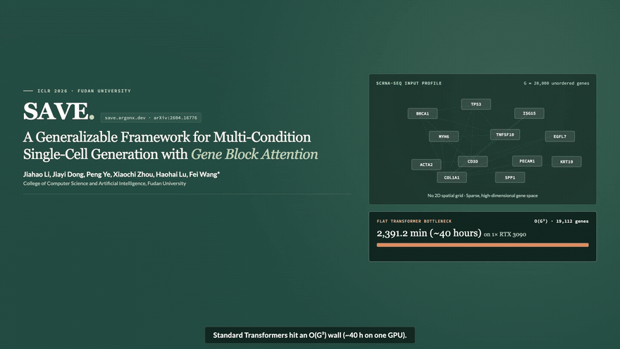
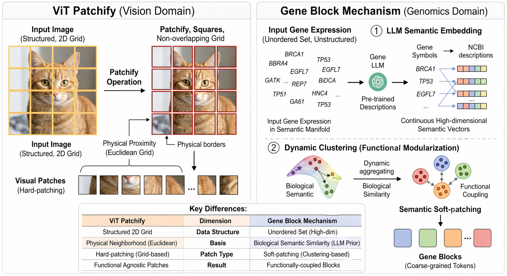
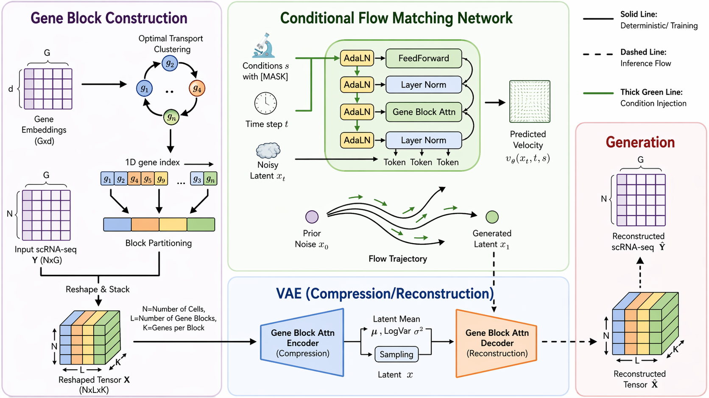
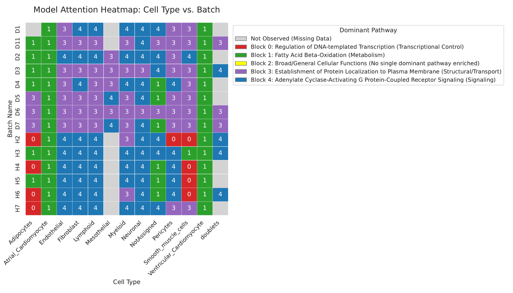

<div align="center">

<h1>SAVE: A Generalizable Framework for Multi-Condition Single-Cell Generation with Gene Block Attention</h1>

<p>
  <strong>Jiahao Li</strong>, Jiayi Dong, Peng Ye, Xiaochi Zhou, Haohai Lu, Fei Wang<sup>*</sup>
  <br/>
  <em>College of Computer Science and Artificial Intelligence, Fudan University</em>
</p>

<p>
  <a href="https://save.argonx.dev"></a>
  <a href="https://pypi.org/project/sc-save/"></a>
  <a href="https://colab.research.google.com/github/fdu-wangfeilab/sc-save/blob/main/notebooks/SAVE_ICLR2026_Reproduce_Colab.ipynb"></a>
  <a href="https://openreview.net/forum?id=l7QEoK4uDP"></a>
  <a href="https://arxiv.org/abs/2604.16776"></a>
  <a href="https://save.argonx.dev/#video"></a>
</p>

<p>
  <a href="https://github.com/fdu-wangfeilab/sc-save/stargazers"></a>
  <a href="https://github.com/fdu-wangfeilab/sc-save/actions/workflows/ci.yml"></a>
  <a href="https://pypi.org/project/sc-save/"></a>
  <a href="LICENSE"></a>
  <a href="#environment-installation"></a>
  <a href="#environment-installation">= 2.2" /></a>
</p>

<p>
  <strong>ViT Patchify for genomics:</strong> SAVE partitions ~20,000 unordered genes into pathway-coherent <strong>Gene Blocks</strong> via LLM semantic embeddings + balanced Optimal Transport, pairing a <strong>Gene-Block Attention VAE</strong> with <strong>DiT Latent OT Flow Matching</strong> for <strong>191× faster</strong> multi-condition single-cell generation, zero-shot batch correction, and perturbation prediction — now on PyPI (<code>pip install sc-save</code>).
</p>

<p>
  <a href="#highlights">Highlights</a> &middot;
  <a href="#30-second-quickstart">30s Quickstart</a> &middot;
  <a href="#overview">Overview</a> &middot;
  <a href="#whats-new-in-v020-efficiency-memory--package-highlights">v0.2.0 Highlights</a> &middot;
  <a href="#key-results">Key Results</a> &middot;
  <a href="#python-api--unified-cli-quickstart">Python API &amp; CLI</a> &middot;
  <a href="#iclr-2026-reproduction-quickstart">Reproduce ICLR 2026</a> &middot;
  <a href="#biological-interpretability">Interpretability</a> &middot;
  <a href="#citation">Citation</a>
</p>

</div>

---

<p align="center">
  <a href="https://save.argonx.dev/#video">
    
  </a>
</p>
<p align="center">
  <em>Watch the <a href="https://save.argonx.dev/#video">2:38 narrated overview video</a> &middot; Try the <a href="https://colab.research.google.com/github/fdu-wangfeilab/sc-save/blob/main/notebooks/SAVE_Quickstart_Tutorial.ipynb">Quickstart Tutorial in Colab</a> &middot; <a href="https://colab.research.google.com/github/fdu-wangfeilab/sc-save/blob/main/notebooks/SAVE_ICLR2026_Reproduce_Colab.ipynb">Reproduce ICLR 2026 Tables 1–5</a></em>
</p>

## Highlights

- **LLM Semantic Gene Blocks (`O(G²) → O(L²)`, 191× Speedup):** Replaces rigid 2D image patching with 1,536-dim NCBI GenePT LLM embeddings + balanced Optimal Transport clustering, cutting single-RTX-3090 training time from **2,391.2 min (~40 h)** down to **12.5 min** (`191×`; `266×` / `9.0 min` at $K=5600$).
- **One Unified Framework Across 8 Benchmarks:** Combines a Gene-Block Attention VAE with DiT Conditional OT Flow Matching (`AdaLN`, condition masking $p=0.6$, multi-condition CFG) to achieve SOTA multi-condition generation (1–5 covariates, including unseen combinations), up to **0.83 scIB** zero-shot batch correction, and **0.96 PCC / 0.86 $R^2$** leave-one-out perturbation prediction.
- **Production-Ready `sc-save v0.2.0` on PyPI:** Ships a clean `sc_save` Python API and unified `sc-save` CLI with pure-PyTorch OT Flow Matching (`flow-matching`/`torchdiffeq` optional), up to **8.43× faster** generation, **196k+ cells** inside **52 GB RAM**, and **10/10** ICLR 2026 Colab validation benchmarks passed with zero regressions.
- **Pathway-Level Biological Interpretability:** Condition-modulated Transformer attention naturally recovers tissue- and cell-type-specific gene programs (e.g., Fatty Acid $\beta$-Oxidation in cardiomyocytes) while suppressing non-discriminative background blocks.

## 30-Second Quickstart

```bash
pip install sc-save        # core Python API + CLI (or: pip install "sc-save[all]")
```

```python
import scanpy as sc
from sc_save import SAVE, SAVEConfig, build_gene_blocks, load_gene_embeddings

adata = sc.read_h5ad("heart_raw.h5ad")
blocks = build_gene_blocks(adata, load_gene_embeddings("GenePT.pickle"), block_size=3200)

model = SAVE(blocks.adata, condition_cols=("batch", "cell_type"), config=SAVEConfig.save_b(), device="auto")
model.fit()

gen = model.generate({"batch": "donor_1", "cell_type": "Cardiomyocyte"}, n_cells=500, steps=20)
transferred = model.transfer(blocks.adata, target_cond={"batch": "donor_1"}, input_cond="obs")
```

See [Python API & Unified CLI Quickstart](#python-api--unified-cli-quickstart) for full `.save()`/`.load()`, `generate_like()`, and `sc-save` CLI usage, or jump straight to [What's New in v0.2.0](#whats-new-in-v020-efficiency-memory--package-highlights).

---

## Overview

**SAVE** is a unified conditional generative framework for multi-condition single-cell RNA-seq modeling built around three core pillars: **LLM biological knowledge**, a **Latent Flow Matching tech stack**, and **191× training efficiency**:

- **LLM Biological Knowledge (Semantic Gene Embeddings → OT Gene Blocks):** Unlike vision pixels on a regular 2D grid, genes form an unordered, sparse set. SAVE encodes curated **NCBI Gene** functional summaries using a pre-trained LLM (GenePT, 1,536-dimensional semantic embeddings) and solves iterative **Optimal Transport** clustering to partition ~20,000 genes into $L$ balanced, pathway-coherent **Gene Blocks** ($K = 3200$).
- **Latent Flow Matching Tech Stack (Gene-Block VAE + DiT OT-FM):** Compresses structured gene blocks ($X \in \mathbb{R}^{N \times L \times K}$) into a compact biological latent space ($z \in \mathbb{R}^{N \times L \times d}$) via a Gene-Block Attention VAE, then trains a **DiT-based Conditional Optimal-Transport Flow Matching** model (`AdaLN`, independent condition masking $p = 0.6$, multi-condition Classifier-Free Guidance) in latent space—unifying 1–5 condition generation (including unseen combinations), zero-shot batch correction, and out-of-sample perturbation prediction across **8 benchmarks** with one fixed configuration.
- **Ultra-High Efficiency (191× Speedup & 20-Step ODE Sampling):** Grouping $G \approx 19{,}112$ flat genes into $L = 6$ semantic blocks collapses self-attention complexity from $\mathcal{O}(G^2)$ to $\mathcal{O}(L^2)$, cutting single-RTX-3090 (24 GB) training time from **2,391.2 min (~40 h)** down to **12.5 min (191× speedup; 266× / 9.0 min at $K=5600$)**—and in `sc-save v0.2.0` Colab GPU validation, accelerating standalone single-GPU training + generation on `lung_cancer` by **2.27×** (**8.43×** faster generation) even on an A100 vs. the v1 Blackwell G4 baseline—while learning biologically interpretable pathway attention.

---

## What's New in v0.2.0: Efficiency, Memory & Package Highlights

`sc-save v0.2.0` is now live on PyPI (`pip install sc-save` / `pip install "sc-save[all]"`), modularizing the codebase into the `sc_save` Python API and unified `sc-save` CLI with pure-PyTorch OT Flow Matching (`flow-matching` and `torchdiffeq` optional) and full `sc_save_public` backward compatibility. Across Google Colab GPU validation ([`results/iclr2026_v2_colab_validation.json`](results/iclr2026_v2_colab_validation.json)), `v0.2.0` passed all **10/10 primary ICLR 2026 benchmarks** with **zero regression gate failures**, matching or outperforming both the `v1` Blackwell G4 baseline and paper targets while dramatically accelerating generation and bounding host RAM on atlas-scale datasets:

| Benchmark (`v0.2.0` GPU vs. `v1` Blackwell G4) | VAE Train | FM Train | Generation | Total Speedup | Quality (`v1` → **`v0.2.0`**) |
| :--- | :---: | :---: | :---: | :---: | :--- |
| **Lung Cancer** (114,692 cells, 5 conds · dedicated A100) | `1273.9s → 626.8s` (**2.03×**) | `1447.3s → 686.2s` (**2.11×**) | `364.5s → 43.2s` (**8.43×**) | **2.27×** | Unseen WD `5.39` → **`4.42`** (paper `4.63`), $R^2$ `0.647` → **`0.698`** |
| **Dentate Gyrus** (14,570 cells · A100 conc. 2) | `198.2s → 118.0s` (**1.68×**) | `332.4s → 92.7s` (**3.59×**) | `25.6s → 13.6s` (**1.88×**) | **2.48×** | WD `8.08` → **`8.11`** (paper `9.16`), PCC **`0.991`** |
| **PBMC3K** (2,110 cells · A100 conc. 2) | `35.3s → 27.3s` (**1.29×**) | `58.2s → 24.1s` (**2.42×**) | `5.7s → 1.5s` (**3.71×**) | **1.87×** | WD `12.76` → **`12.74`** (paper `19.14`), PCC `0.943` → **`0.948`** |
| **Lung Atlas / PBMC** (Table 2 · 3-way conc. on 1 A100) | — | **1.26× / 1.34×** | **5.68× / 3.52×** | **1.08× / 1.09×** | Heart WD `8.83` → **`8.20`**, PBMC WD `5.39` → **`5.30`** |
| **Tabula Muris** (196,311 × 22,400 · **L4 22 GB / 52 GB RAM**) | Runs end-to-end inside **52 GB host RAM** (streaming PCA + tiled RBF-MMD ≤ 16 MB) | — | — | Bounded RAM | WD `10.65` → **`10.21`**, MMD `0.036` → **`0.033`**, $R^2$ `0.952` → **`0.959`** |

- **Faster Training**: Adaptive GPU residency (FP32/FP16/pinned-CPU tiers), chunked host-to-GPU transfers, streaming frozen-VAE posterior precomputation, `bfloat16` FM autocast, and removal of per-step GPU→CPU synchronization checks.
- **Up to 8.43× Faster Generation & Transfer**: Pure-PyTorch `CondOTPath`/`VPPath`/`VEPath` and fixed-step ODE/SDE solvers with fused `[2*B]` CFG plus single-pass batched `SAVE.generate_like(...)` and `SAVE.transfer(..., input_cond="obs")`.
- **Atlas-Scale Memory Safety (196k+ Cells in 52 GB RAM)**: In-place `MaxAbsExpressionScaler`, `copy_adata=False`, preallocated generation outputs, exact streaming randomized PCA, and exact tiled RBF-MMD (`<= 16 MB` tiles) with shared `cdist` OT-EMD.
- **Clean Python Package & CLI**: `pip install sc-save`, high-level `SAVE` / `SAVEConfig` API with `.save()`/`.load()` (`0.0` GPU reload diff), unified `sc-save` CLI, and optional collision-free `cond_encoding="offset"` mode.

See [Python API & CLI Quickstart](#python-api--unified-cli-quickstart), [Verified ICLR 2026 Baselines](#verified-iclr-2026-colab-baselines-v1-g4-vs-sc-save-v020-a100l4), and [`REPRODUCIBILITY.md`](REPRODUCIBILITY.md) for code examples and complete Tables 1–5 breakdowns.

### LLM Semantic Gene Blocks vs. ViT Patchify

Standard Transformer models either attend over ~20,000 flat genes ($\mathcal{O}(G^2)$ memory/time bottleneck) or lack a spatial 2D neighborhood for Vision Transformer (ViT) grid patching. SAVE replaces spatial proximity with **LLM semantic similarity + balanced Optimal Transport soft-patching** before feeding structured tokens into the **Latent VAE + Latent Flow Matching** stack:

<p align="center">
  
</p>
<p align="center">
  <em><strong>Figure 1. ViT Patchify (Vision) vs. SAVE Gene Block Mechanism (Genomics).</strong> Instead of hard-patching a structured 2D pixel grid by Euclidean proximity, SAVE extracts 1,536-dim LLM semantic embeddings from NCBI gene summaries (Stage 1) and performs balanced Optimal Transport clustering (Stage 2) to form pathway-coupled Gene Blocks for downstream Latent VAE compression and Latent Flow Matching.</em>
</p>

1. **Stage 1 — LLM Semantic Embedding:** Curated NCBI Gene text descriptions are encoded with a pre-trained LLM (`text-embedding-ada-002`, GenePT) into continuous 1,536-dim semantic vectors $g_i$, injecting prior biological functional knowledge directly into tokenization.
2. **Stage 2 — Balanced Optimal Transport Soft-Patching → Latent FM:** Iterative Optimal Transport minimizes squared Euclidean cost $C_{ij} = \|g_i - c_j^{(t)}\|_2^2$ under uniform marginal constraints ($T\mathbf{1}_L = a,\ T^\top \mathbf{1}_G = b$), yielding non-overlapping, equal-size functional blocks $X \in \mathbb{R}^{N \times L \times K}$ that serve as compact tokens for **Latent VAE + OT Flow Matching**.

| Dimension | ViT Patchify (Vision Domain) | SAVE Gene Block Mechanism (Genomics Domain) |
| :--- | :--- | :--- |
| **Input Data Structure** | Structured 2D pixel grid | Unordered, high-dimensional & sparse gene set (~20,000 genes) |
| **Grouping Basis** | Physical proximity (Euclidean grid) | **Biological semantic similarity (pre-trained LLM prior on NCBI descriptions)** |
| **Patching Type** | Hard-patching (fixed spatial grid) | **Semantic soft-patching (iterative balanced Optimal Transport clustering)** |
| **Token Properties** | Functionally agnostic image patches | **Functionally coupled pathway blocks** (coherent gene programs) |
| **Downstream Stack & Efficiency** | Flat patch ViT attention | **Latent VAE + Latent OT Flow Matching** ($\mathcal{O}(L^2)$ attention, **191× training speedup**: 12.5 min vs. 2,391.2 min on RTX 3090) |

### End-to-End Architecture: Latent VAE + Latent Flow Matching

Once LLM-guided Optimal Transport constructs balanced Gene Blocks ($X \in \mathbb{R}^{N \times L \times K}$), a Gene-Block Attention VAE compresses expressions into compact latents $z \in \mathbb{R}^{N \times L \times d}$, where DiT Conditional Optimal-Transport Flow Matching models multi-condition cellular trajectories in 20 ODE steps:

<p align="center">
  
</p>
<p align="center">
  <em><strong>Figure 2. Overview of SAVE.</strong> (Left) LLM-embedded NCBI gene summaries are clustered via Optimal Transport into balanced gene blocks ($X \in \mathbb{R}^{N \times L \times K}$). (Bottom) A Gene-Block Attention VAE compresses profiles into pathway-structured latents $z \in \mathbb{R}^{N \times L \times d}$. (Top) Latent Conditional Optimal-Transport Flow Matching with AdaLN and condition masking generates unseen multi-condition cell states, corrects batch effects, and transfers perturbations.</em>
</p>

---

## Key Results

### 1. Dual-Condition Generation (`batch` + `cell_type`)

Quantitative comparison on three multi-platform scRNA-seq datasets (Wasserstein Distance $\downarrow$ and Maximum Mean Discrepancy $\downarrow$; **bold** = best, *italic* = second best):

| Method | Heart WD $\downarrow$ | Heart MMD $\downarrow$ | PBMC WD $\downarrow$ | PBMC MMD $\downarrow$ | Lung Atlas WD $\downarrow$ | Lung Atlas MMD $\downarrow$ |
| :--- | :---: | :---: | :---: | :---: | :---: | :---: |
| scVI | 19.18 | 1.19 | 17.75 | 0.95 | 22.20 | 2.27 |
| CFGen | *12.57* | *0.66* | 17.41 | 0.65 | 28.02 | 1.76 |
| scDiffusion | 20.82 | 0.94 | *11.38* | *0.48* | *13.89* | *1.71* |
| **SAVE** | **8.30** | **0.63** | **5.37** | **0.29** | **4.37** | **1.14** |

<p align="center">
  
</p>
<p align="center">
  <em><strong>Figure 3. Dual-condition generation on Heart.</strong> Top: generated vs. ground-truth overlap; Middle: sequencing batches; Bottom: cell types. SAVE accurately preserves both multi-batch structure and cell-type topology.</em>
</p>

---

### 2. Multi-Condition Generation & Unseen Extrapolation (5 Covariates)

Evaluated on the **Lung Cancer** benchmark across 5 simultaneous covariates (`assay`, `development_stage`, `disease`, `uicc_stage`, `cell_type`), including held-out **unseen** combinations:

| Method | Seen WD $\downarrow$ | Seen MMD $\downarrow$ | Unseen WD $\downarrow$ | Unseen MMD $\downarrow$ |
| :--- | :---: | :---: | :---: | :---: |
| CFGen | 16.94 ± 4.19 | 1.49 ± 1.80 | 23.67 ± 3.08 | 2.76 ± 2.64 |
| scDiffusion | *5.27 ± 2.14* | *1.06 ± 1.59* | *5.29 ± 2.03* | **1.87 ± 2.31** |
| **SAVE** | **3.10 ± 0.96** | **1.06 ± 1.48** | **4.63 ± 0.95** | *2.11 ± 2.11* |

<p align="center">
  
</p>
<p align="center">
  <em><strong>Figure 4. Five-condition generation on Lung Cancer.</strong> (a) Seen combination (Smart-seq2, 60-year-old, lung adenocarcinoma, stage IV); (b) Unseen held-out combination (Smart-seq2, 70-year-old, squamous cell lung carcinoma, stage I).</em>
</p>

---

### 3. Out-of-Sample Perturbation Prediction (PBMC IFN-$\beta$)

Leave-one-cell-type-out counterfactual prediction of IFN-$\beta$ stimulation response across all 7 PBMC cell types (PCC $\uparrow$ / $R^2$ $\uparrow$):

| Method | CD8T | CD14+Mono | FCGR3A+Mono | B | CD4T | Dendritic | NK | Average |
| :--- | :---: | :---: | :---: | :---: | :---: | :---: | :---: | :---: |
| control | 0.94 / 0.88 | 0.75 / 0.32 | 0.78 / 0.38 | 0.91 / 0.81 | 0.94 / 0.87 | 0.79 / 0.51 | 0.93 / 0.84 | 0.86 / 0.66 |
| scDisInFact | 0.85 / 0.43 | 0.77 / 0.47 | 0.71 / 0.43 | 0.84 / 0.45 | 0.85 / 0.43 | 0.76 / 0.47 | 0.79 / 0.44 | 0.80 / 0.45 |
| MFM | 0.78 / 0.60 | 0.77 / 0.53 | 0.56 / 0.08 | 0.70 / 0.49 | 0.70 / 0.49 | 0.72 / 0.51 | 0.72 / 0.51 | 0.71 / 0.46 |
| trVAE | *0.98* / 0.96 | 0.82 / 0.39 | 0.83 / 0.32 | 0.90 / 0.78 | **0.97** / *0.94* | 0.83 / 0.46 | **0.97** / **0.92** | 0.90 / 0.68 |
| scGEN | 0.96 / 0.88 | *0.95* / 0.80 | **0.93** / **0.77** | *0.91* / *0.83* | 0.92 / 0.85 | **0.96** / **0.89** | 0.93 / 0.84 | *0.94* / *0.84* |
| CellOT | **0.99** / **0.97** | **0.99** / **0.98** | 0.77 / 0.02 | 0.95 / 0.89 | **0.97** / *0.94* | **0.96** / *0.88* | *0.96* / *0.90* | *0.94* / 0.80 |
| **SAVE** | *0.98* / **0.97** | *0.97* / *0.89* | *0.91* / *0.53* | **0.97** / **0.94** | *0.96* / **0.97** | **0.96** / 0.81 | *0.96* / *0.90* | **0.96** / **0.86** |

<p align="center">
  
</p>
<p align="center">
  <em><strong>Figure 5. Perturbation prediction on PBMC IFN-$\beta$.</strong> Top: UMAP alignment against ground-truth stimulated cells across all 7 held-out cell types; Bottom: predicted expression distributions of key interferon-response markers (<code>ISG15</code>, <code>TNFSF10</code>).</em>
</p>

---

### 4. Batch Effect Correction (Zero Task-Specific Training)

Without explicit batch-integration objectives, SAVE's condition-aware latent space naturally disentangles technical batch variation from biological identity (scIB metrics $\uparrow$):

| Method | Lung Bio | Lung Batch | Lung scIB | Heart Bio | Heart Batch | Heart scIB | PBMC Bio | PBMC Batch | PBMC scIB |
| :--- | :---: | :---: | :---: | :---: | :---: | :---: | :---: | :---: | :---: |
| Scanorama | *0.70* | 0.88 | 0.77 | 0.72 | 0.82 | 0.76 | 0.71 | 0.93 | 0.80 |
| Harmony | 0.65 | **0.93** | 0.76 | **0.76** | **0.89** | **0.81** | 0.71 | **0.95** | 0.80 |
| scVI | 0.58 | 0.83 | 0.68 | 0.66 | 0.81 | 0.72 | 0.47 | 0.78 | 0.59 |
| trVAE | 0.69 | 0.90 | *0.78* | 0.75 | 0.83 | 0.78 | **0.75** | 0.91 | *0.82* |
| **SAVE** | **0.73** | **0.93** | **0.81** | **0.76** | *0.86* | *0.80* | **0.75** | **0.95** | **0.83** |

---

### 5. Training Efficiency & Block Size Scaling

Measured on Heart (19,112 genes) on a single NVIDIA RTX 3090 (24GB VRAM):

| Block Size ($K$) | Num. Blocks ($L$) | Training Time | Speedup | Heart WD $\downarrow$ | Heart MMD $\downarrow$ |
| :--- | :---: | :---: | :---: | :---: | :---: |
| `1` (naive gene-level) | 19,112 | 2391.2 min | 1.0× | — | — |
| `1600` | 12 | 16.4 min | 146× | 9.64 | 0.65 |
| **`3200` (default)** | **6** | **12.5 min** | **191×** | **8.30** | **0.63** |
| `5600` | 4 | 9.0 min | 266× | 8.41 | 0.63 |

> Removing Gene Block Attention (`SAVE w/o Att.`) degrades Heart generation performance from WD **8.30** / MMD **0.63** to WD 8.89 / MMD 0.65.

---

## Biological Interpretability

Extracting condition-modulated attention weights from the Flow Matching Transformer on Heart (16,000 HVGs partitioned into 5 blocks of size 3,200) confirms that SAVE attends to biologically coherent pathways:

<p align="center">
  
</p>

- **Physiological Alignment:** Atrial and ventricular cardiomyocytes consistently attend to **Block 1** (Fatty Acid $\beta$-Oxidation), matching the heart's primary lipid metabolism signature across batches.
- **Functional Specificity:** Endothelial cells and fibroblasts dynamically shift attention toward **Block 4** (Adenylate Cyclase-Activating GPCR Signaling) and **Block 3** (Protein Localization to Plasma Membrane), reflecting extracellular signaling and structural roles.
- **Biological Filtering:** **Block 2** (Broad/General Cellular Functions without a dominant pathway) is universally suppressed across conditions, demonstrating autonomous filtering of non-discriminative gene programs.

---

## Released Modules & Repository Layout

| Module | Package / CLI | Script Entrypoint |
| :--- | :--- | :--- |
| Core Python API (`SAVE`, `SAVEConfig`, `build_gene_blocks`) | `sc_save` | [`notebooks/SAVE_Quickstart_Tutorial.ipynb`](notebooks/SAVE_Quickstart_Tutorial.ipynb) |
| Dataset Preparation (Tables 1–5 & GenePT) | `sc-save prepare-datasets` | [`examples/prepare_datasets.py`](examples/prepare_datasets.py) |
| Gene Block Construction | `sc-save build-blocks` | [`examples/gene_block_construction/run_pipeline.py`](examples/gene_block_construction/run_pipeline.py) |
| Conditional Generation (VAE + OT FM) | `sc-save train` / `sc-save generate` | [`examples/conditional_generation/run_formal.py`](examples/conditional_generation/run_formal.py) / [`run_hca_formal.py`](examples/conditional_generation/run_hca_formal.py) / [`run_hca_smoke.py`](examples/conditional_generation/run_hca_smoke.py) |
| Conditional Distribution Evaluation | `sc-save evaluate` | [`examples/conditional_distribution_evaluation/run_example.py`](examples/conditional_distribution_evaluation/run_example.py) |
| Batch Effect Correction (scIB Benchmark) | `sc-save bec` | [`examples/bec_integration/run_bec.py`](examples/bec_integration/run_bec.py) |
| Perturbation Prediction (Single & LOO) | `sc-save perturb` | [`examples/perturbation_prediction/run_single.py`](examples/perturbation_prediction/run_single.py) / [`run_leave_one_out.py`](examples/perturbation_prediction/run_leave_one_out.py) |
| Unified ICLR 2026 Reproduction | `sc-save reproduce` | [`examples/reproduce_iclr2026.py`](examples/reproduce_iclr2026.py) · [`notebooks/SAVE_ICLR2026_Reproduce_Colab.ipynb`](notebooks/SAVE_ICLR2026_Reproduce_Colab.ipynb) |

```text
src/sc_save/          Primary sc-save v0.2.0 package (config, data, nn, training, model, eval, workflows, cli)
src/sc_save_public/   Backward-compatible v1 shims re-exporting sc_save modules
examples/             Runnable CLI entrypoints & unified ICLR 2026 orchestrator
notebooks/            Quickstart tutorial & Google Colab G4/H100/A100 ICLR 2026 reproduction notebook
results/              Verified ICLR 2026 baselines (iclr2026_colab_repro.json v1 G4 & iclr2026_v2_colab_validation.json v0.2.0 A100/L4)
tests/                Offline unit, parity & API test coverage
docs/assets/          Paper figures and visual assets
REPRODUCIBILITY.md    Detailed ICLR 2026 paper reproduction guide & verified v1 / v0.2.0 Colab comparison tables
CHANGELOG.md          Release history
```

---

## Python API & Unified CLI Quickstart

Install `sc-save` from PyPI (or from source as shown under [Installation](#environment-installation)) and train, generate, transfer, save, and reload models in just a few lines—also see [`notebooks/SAVE_Quickstart_Tutorial.ipynb`](notebooks/SAVE_Quickstart_Tutorial.ipynb):

```python
import scanpy as sc
from sc_save import SAVE, SAVEConfig, build_gene_blocks, load_gene_embeddings

# 1. Load scRNA-seq AnnData & precomputed GenePT embeddings, then construct OT gene blocks
adata = sc.read_h5ad("heart_raw.h5ad")
gene_embs = load_gene_embeddings("GenePT_gene_protein_embedding_model_3_text.pickle")
blocks = build_gene_blocks(adata, gene_embs, block_size=3200)

# 2. Configure and train Stage-1 Attention VAE + Stage-2 Latent Flow Matching
cfg = SAVEConfig.save_b(gene_block_size=3200, cond_encoding="offset")
model = SAVE(blocks.adata, condition_cols=("batch", "cell_type"), config=cfg, device="auto")
model.fit()

# 3. Encode, generate, and perform zero-shot batch/condition transfer
z = model.encode(with_cond=False, latent_pos=1)
gen = model.generate({"batch": "donor_1", "cell_type": "Cardiomyocyte"}, n_cells=500, steps=20)
gen_matched = model.generate_like(blocks.adata, steps=20)  # single batched pass matching target obs
transferred = model.transfer(blocks.adata, target_cond={"batch": "donor_1"}, input_cond="obs")

# 4. Save and reload complete bundle (config, vocab, scaler, VAE & FM weights)
model.save("./outputs/save_heart_bundle")
reloaded = SAVE.load("./outputs/save_heart_bundle", device="auto")
```

Or drive every stage directly from the unified `sc-save` CLI:

```bash
sc-save --version
sc-save build-blocks --data-path input.h5ad --gene-embedding-path genept.pickle --gene-block-size 3200
sc-save train --data-path processed.h5ad --cond-cols batch cell_type --preset save_b --output-dir ./outputs/model
sc-save generate --model-dir ./outputs/model --cond batch=b1 cell_type=T --n-cells 200 --output-dir ./outputs/gen
sc-save evaluate --gt-path target.h5ad --gen-path ./outputs/gen/generation.h5ad --cond-cols batch cell_type
sc-save bec --data-path bec_gbs400.h5ad --task-name lung_atlas_bec --scib-workers 8
sc-save perturb --data-path pbmc_ifn_gbs400.h5ad --workers auto
sc-save reproduce --tasks all --data-root ./data --gpu-workers auto --cpu-workers auto
```

---

## ICLR 2026 Reproduction Quickstart

[](https://colab.research.google.com/github/fdu-wangfeilab/sc-save/blob/main/notebooks/SAVE_ICLR2026_Reproduce_Colab.ipynb)

All five quantitative benchmarks (**Tables 1–5**) can be reproduced either in **Google Colab Pro+ (G4 96 GB / H100 / A100)** or locally via `sc-save reproduce` or [`examples/reproduce_iclr2026.py`](examples/reproduce_iclr2026.py):

```bash
# Preview execution plan and expected output paths
sc-save reproduce --tasks all --data-root ./data --dry-run

# Run all 5 paper tables end-to-end with GPU & CPU parallelism (auto-saturates >=40/75 GB GPUs)
sc-save reproduce \
  --tasks all \
  --data-root ./data \
  --output-root ./outputs/iclr2026 \
  --gpu-workers auto \
  --cpu-workers auto \
  --prep-workers 4 \
  --device 0

# Or via the standalone script (supports all identical flags)
python examples/reproduce_iclr2026.py --tasks table2 --data-root ./data --output-root ./outputs/iclr2026 --gpu-workers auto --device 0
```

### Verified ICLR 2026 Colab Baselines (`v1` G4 vs. `sc-save v0.2.0` A100/L4)

> **Validation Status**: **`sc-save v0.2.0`** passed all **10/10** primary ICLR 2026 benchmarks across Tables 1–5 with **zero regression gate failures** (`all_regression_gates_passed: true`) in [`results/iclr2026_v2_colab_validation.json`](results/iclr2026_v2_colab_validation.json), alongside the preserved v1 (`0.1.0` / `reproduce-iclr2026@307c925`) Blackwell G4 baseline in [`results/iclr2026_colab_repro.json`](results/iclr2026_colab_repro.json).

- **v1 Baseline Hardware**: `NVIDIA RTX PRO 6000 Blackwell Server Edition` (`94.97 GB` VRAM, PyTorch `2.14.1+cu130`, CUDA `13.0`; `5,295s` / `88m 15s` wall-clock for parallel Tables 1–4, `~7m` for single-run `heart`).
- **v0.2.0 Validation Hardware**:
  - `NVIDIA A100-SXM4-80GB` (`79.25 GB` VRAM, PyTorch `2.14.1+cu130`, CUDA `13.0`) for `test` (`pytest` + GPU API smoke with `0.0` reload diff), `prepare`, all of Tier 1 (`pbmc3k`, `dentategyrus`, `heart`, `pbmc`, `lung_atlas`, `heart_bec`, `pbmc_bec`, `lung_atlas_bec`, `pbmc_ifn`), and Tier 2 `lung_cancer` (**2.27×** total / **8.43×** generation speedup vs. v1 Blackwell).
  - `NVIDIA L4` High-RAM (`22.03 GB` VRAM, `52 GB` host RAM) for Tier 2 `tabula_muris` (`196,311 × 22,400`, using streaming randomized PCA + tiled RBF-MMD) and Tier 3 `heart` `cond_encoding="offset"` A/B (`WD 8.53 / MMD 0.62 / PCC 0.8730`). Optional Tier 3 `offset` reruns on `pbmc_ifn` (upstream Dropbox link temporarily disabled) and `lung_cancer` (52 GB L4 host-RAM ceiling during raw HVG prep) were skipped after their main Table 3 & 5 `legacy` benchmarks had already passed on A100.

| Benchmark | Key Metric(s) | Paper Target | v1 Colab (Blackwell G4) | **v0.2.0 Colab (A100 / L4)** |
| :--- | :--- | :---: | :---: | :---: |
| **Table 1** (`pbmc3k` / `dentategyrus` / `tabula_muris`) | WD ($\downarrow$) / MMD ($\downarrow$) | `19.14/1.80` · `9.16/0.17` · `10.86/0.04` | `12.76/0.48` · `8.08/0.11` · `10.65/0.04` | **`12.74/0.49` · `8.11/0.11` · `10.21/0.03`** |
| **Table 2** (`heart` / `pbmc` / `lung_atlas`) | WD ($\downarrow$) / MMD ($\downarrow$) | `8.30/0.63` · `5.37/0.29` · `4.37/1.14` | `8.83/0.64` · `5.39/0.30` · `4.42/1.16` | **`8.20/0.61` · `5.30/0.29` · `4.41/1.15`** |
| **Table 3** (`lung_cancer` Seen / Unseen) | WD ($\downarrow$) / MMD ($\downarrow$) | `3.10/1.06` · `4.63/2.11` | `3.07/1.08` · `5.39/2.16` | **`3.05/1.07` · `4.42/2.07`** |
| **Table 4** (`lung_atlas` / `heart` / `pbmc` BEC) | scIB ($\uparrow$) | `0.8128` · `0.7983` · `0.8309` | `0.8097` · `0.8019` · `0.8125` | **`0.8080` · `0.7985` · `0.8238`** |
| **Table 5** (`pbmc_ifn` 7-fold LOO Average) | PCC ($\uparrow$) / $R^2$ ($\uparrow$) / WD ($\downarrow$) | `0.96` / `0.86` / `5.15` | `0.943` / `0.807` / `5.77` | **`0.940` / `0.792` / `5.86`** |

See [`REPRODUCIBILITY.md`](REPRODUCIBILITY.md) for dataset URLs, model hyperparameters, per-dataset speedups (`v1` vs. `v0.2.0`), condition-encoding A/B comparison, and complete Tables 1–5 breakdowns.

---

## Environment Installation

`sc-save` supports Python `>= 3.10` and PyTorch `>= 2.2.0` (preserving preinstalled CUDA PyTorch in Colab / workstation environments):

- **Core stack**: `anndata`, `einops`, `numpy>=1.26.4`, `pandas>=2.2.0,<3.0`, `POT`, `scanpy`, `scikit-learn`, `scipy`, `torch>=2.2.0`, `tqdm` (with pure-PyTorch `CondOTPath`, `VPPath`, `VEPath`, and `euler`/`midpoint`/`rk4` solvers built in).
- **Optional extras in `pyproject.toml`**:
  - `[solvers]`: `flow-matching`, `torchdiffeq` (for adaptive ODE solvers such as `dopri5`)
  - `[viz]`: `matplotlib`, `pyparsing`
  - `[bec]`: `scib`, `igraph`, `leidenalg`
  - `[datasets]`: `gdown`, `pyyaml`, `requests`
  - `[all]`: all extras combined

```bash
# Install from PyPI (core package + CLI)
pip install sc-save

# Or install with all benchmark/dataset/evaluation extras
pip install "sc-save[all]"
```

From a local repository clone:

```bash
# Using uv
uv sync --extra all

# Or using pip inside an existing CUDA PyTorch environment
pip install -e ".[all]"
```

Optional verification:

```bash
pytest -v
sc-save --version
sc-save reproduce --tasks all --dry-run
```

Notes:

- `flash-attn` is optional and is not required for the public examples. The released configs keep `is_flash_attn=False`.
- `flow-matching` and `torchdiffeq` are optional (`[solvers]`); core generation uses pure-PyTorch OT Flow Matching and fixed-step ODE/SDE solvers.
- The public workflow does not require `timm`, `torchvision`, or `rpy2`.

---

## Dataset Preparation CLI

Download, standardize, normalize (`log1p`-only for Table 2 dual-condition; `normalize_total(1e4)` + `log1p` for Tables 1, 3, 4, and 5), HVG-filter, and OT-partition (`ot.emd`, `numItermax=1000000`) all ICLR 2026 benchmark datasets and GenePT v2 embeddings via [`examples/prepare_datasets.py`](examples/prepare_datasets.py):

```bash
# List all registered datasets, verified public URLs, and processed output paths
python examples/prepare_datasets.py --list-datasets

# Download and preprocess all datasets for Tables 1-5 concurrently
python examples/prepare_datasets.py --datasets all --data-root ./data --workers auto

# Or prepare a single table group or subset of datasets
python examples/prepare_datasets.py --datasets table2 --data-root ./data --workers 4
python examples/prepare_datasets.py --datasets heart pbmc_ifn --data-root ./data --subset-cells 512
```

Processed `.h5ad` outputs are written under `<data-root>/processed/` alongside `<data-root>/manifest.json`. See [`REPRODUCIBILITY.md`](REPRODUCIBILITY.md) for per-table filenames and source URLs.

---

## Input Data Requirements

Recommended workflow:

1. If your input dataset has not been reorganized into semantic gene blocks yet, first run gene block construction.
2. Use the resulting `processed.h5ad` as input to conditional generation.
3. Use the generated `.h5ad` output together with the target `.h5ad` for evaluation.

For gene block construction, you need:

- an input `.h5ad` dataset
- a pickle file containing a mapping `gene_name -> embedding vector`

If canonical gene symbols are stored in a column such as `adata.var["feature_name"]`, pass that column through `--gene-name-col`.

For conditional generation, the input `.h5ad` should satisfy:

- gene dimension already matches the model-ready representation you want to train on
- in the standard public workflow, this can be the `processed.h5ad` produced by gene block construction
- `adata.obs["batch"]` exists
- `adata.obs["cell_type"]` exists

If your dataset already contains padded genes such as `pad_0`, the generation pipeline will detect them and trim them back out in the saved outputs.

For evaluation, the target and generated `.h5ad` files should represent the same gene space. If the gene names contain the same set in different orders, the evaluation script will reorder the generated object automatically.

---

## Quick Start

### Run Gene Block Construction

Use this step to reorder embedding-covered genes into balanced semantic blocks and pad the output to a full block size. The default public setting is `gene_block_size=3200`.

```bash
uv run python examples/gene_block_construction/run_pipeline.py \
  --data-path /path/to/input.h5ad \
  --gene-embedding-path /path/to/gene_embeddings.pkl \
  --gene-block-size 3200 \
  --output-dir ./outputs/gene_block_construction
```

If your dataset keeps gene symbols in `adata.var["feature_name"]`, add:

```bash
uv run python examples/gene_block_construction/run_pipeline.py \
  --data-path /path/to/input.h5ad \
  --gene-embedding-path /path/to/gene_embeddings.pkl \
  --gene-name-col feature_name \
  --gene-block-size 3200 \
  --output-dir ./outputs/gene_block_construction
```

For a small startup check:

```bash
uv run python examples/gene_block_construction/run_pipeline.py \
  --data-path /path/to/input.h5ad \
  --gene-embedding-path /path/to/gene_embeddings.pkl \
  --subset-cells 512 \
  --gene-block-size 3200 \
  --output-dir ./outputs/gene_block_smoke
```

Main outputs:

- `processed.h5ad`
- `var_metadata.csv`
- `report.json`

### Run Conditional Generation

#### Smoke Run

Use this for a fast end-to-end check on a small subset:

```bash
uv run --extra generation python examples/conditional_generation/run_hca_smoke.py \
  --data-path /path/to/input.h5ad \
  --output-dir ./outputs/conditional_generation_smoke \
  --subset-size 512 \
  --device 0 \
  --seed 1202 \
  --vae-epoch 1 \
  --fm-epoch 1 \
  --batch-size 64 \
  --generate-count 8 \
  --guidance-weights 2.0 \
  --sample-steps 5 \
  --num-heads 4
```

Main outputs:

- `generated_smoke.h5ad`
- `target_smoke.h5ad`
- `gen_z_fm.npy`
- `target_z_vae.npy`
- `report.json`

#### Formal Run

Use `run_formal.py` for arbitrary `--cond-cols` and `--gene-block-size` (Tables 1–3) or `run_hca_formal.py` for the HCA dual-condition preset:

```bash
uv run --extra generation python examples/conditional_generation/run_formal.py \
  --data-path /path/to/input.h5ad \
  --task-name heart \
  --cond-cols batch cell_type \
  --gene-block-size 3200 \
  --output-dir ./outputs/conditional_generation_formal \
  --device 0
```

Or using the backwards-compatible HCA preset:

```bash
uv run --extra generation python examples/conditional_generation/run_hca_formal.py \
  --data-path /path/to/input.h5ad \
  --output-dir ./outputs/conditional_generation_formal \
  --device 0 \
  --num-heads 4
```

Main outputs:

- `generation.h5ad`
- `target.h5ad`
- `gen_z_fm.npy`
- `target_z_vae.npy`
- `report.json`
- `ckpt/`

### Run Conditional Distribution Evaluation

#### Evaluate Smoke Outputs

```bash
uv run python examples/conditional_distribution_evaluation/run_example.py \
  --gt-path ./outputs/conditional_generation_smoke/target_smoke.h5ad \
  --gen-path ./outputs/conditional_generation_smoke/generated_smoke.h5ad \
  --cond-cols batch cell_type \
  --output-dir ./outputs/conditional_generation_smoke_eval \
  --device 0
```

#### Evaluate Formal Outputs

```bash
uv run python examples/conditional_distribution_evaluation/run_example.py \
  --gt-path ./outputs/conditional_generation_formal/target.h5ad \
  --gen-path ./outputs/conditional_generation_formal/generation.h5ad \
  --cond-cols batch cell_type \
  --output-dir ./outputs/conditional_generation_formal_eval \
  --device 0
```

If you only want the main Wasserstein and MMD metrics, skip expression summary metrics:

```bash
uv run python examples/conditional_distribution_evaluation/run_example.py \
  --gt-path /path/to/target.h5ad \
  --gen-path /path/to/generated.h5ad \
  --cond-cols batch cell_type \
  --output-dir ./outputs/conditional_distribution_evaluation \
  --skip-expression-metrics
```

Evaluation outputs:

- `distribution_alignment.csv`
- `per_condition_metrics.csv`
- `report.json`

### Run Perturbation Prediction

Perturbation prediction holds out one cell type at a time, trains (or loads) a SAVE model on the remaining cells, predicts the stimulated expression from control cells, and evaluates against ground truth.

The input `.h5ad` should contain:

- `adata.obs["cell_type"]` — cell-type labels (configurable via `--label-key`)
- `adata.obs["condition"]` — with at least a control and a target value (configurable via `--condition-key`)

#### Single Cell Type

```bash
uv run python examples/perturbation_prediction/run_single.py \
  --data-path /path/to/data.h5ad \
  --cell-type CD8T \
  --output-dir ./outputs/perturbation_CD8T
```

Main outputs:

- `train.h5ad` / `test.h5ad` — unscaled splits
- `SAVE_pred.h5ad` — predicted stimulated cells
- `train_scaler.pkl` — fitted `MaxAbsExpressionScaler`
- `report.json` — parameters, timing, and evaluation metrics (R2, MSE, PCC)

#### Leave-One-Out Evaluation

Loop over all cell types in the dataset:

```bash
uv run python examples/perturbation_prediction/run_leave_one_out.py \
  --data-path /path/to/data.h5ad \
  --workers auto \
  --output-dir ./outputs/perturbation_leave_one_out
```

Run only selected cell types:

```bash
uv run python examples/perturbation_prediction/run_leave_one_out.py \
  --data-path /path/to/data.h5ad \
  --cell-types CD8T NK B
```

In addition to per-cell-type outputs, the leave-one-out script produces a `summary.json` with per-cell-type and average R2, MSE, PCC, WD, and MMD, and prints a summary table to stdout.

### Run Batch Effect Correction (BEC + scIB)

The BEC workflow uses `SAVE-B-perturb` (`gene_block_size=400`, `sample_mask_prob=0.0`, `col_msk_threshold=0.6`) with `LDM_raw` conditional batch transfer across every target batch, followed by 30-PC PCA embedding and parallel pure-Python `scib` evaluation (`avg_bio`, `avg_batch`, `scib_score = 0.6 * avg_bio + 0.4 * avg_batch`):

```bash
python examples/bec_integration/run_bec.py \
  --data-path ./data/processed/table4_bec/lung_atlas_hvg2000_GBS400.h5ad \
  --task-name lung_atlas_bec \
  --output-dir ./outputs/bec_integration/lung_atlas_bec \
  --scib-workers 8 \
  --device 0
```

Main outputs under `--output-dir`:

- `checkpoints/<task_name>.pt`: SAVE checkpoint (automatically reused on rerun unless `--overwrite-ckpt` is passed)
- `embeddings/transfer_to_<batch>.npy`: 30-PC PCA coordinates aligned to `adata.obs_names`
- `scib_eval.csv`: per-target-batch `scib` metrics plus `mean` and `std`
- `report.json`: aggregated `avg_bio`, `avg_batch`, `scib_score`, `PCR_batch`, and sub-metrics matching Table 4

---

## Citation

If you use this repository or the SAVE method in your work, please cite:

```bibtex
@inproceedings{
li2026save,
title={{SAVE}: A Generalizable Framework for Multi-Condition Single-Cell Generation with Gene Block Attention},
author={Jiahao Li and Jiayi Dong and Peng Ye and Xiaochi Zhou and Haohai Lu and Fei Wang},
booktitle={The Fourteenth International Conference on Learning Representations},
year={2026},
url={https://openreview.net/forum?id=l7QEoK4uDP}
}
```

> Also available on [arXiv (2604.16776)](https://arxiv.org/abs/2604.16776) and [OpenReview](https://openreview.net/forum?id=l7QEoK4uDP).

## License

Released under the [MIT License](LICENSE).
